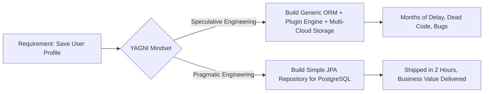
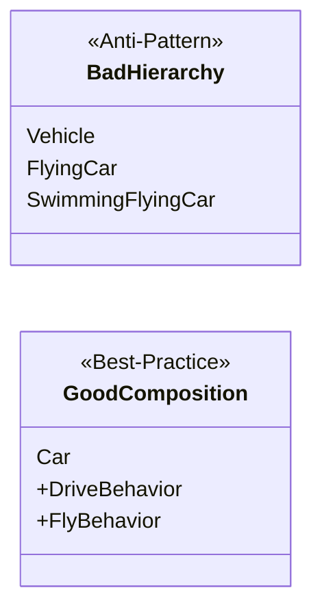

# Core Software Design Principles: DRY, KISS, YAGNI & Essential LLD Tenets

Beyond the object-oriented structure of SOLID, production software architecture is governed by pragmatic design principles that keep systems **lean**, **maintainable**, and **free from over-engineering**.

In system design interviews and real-world engineering at top tier tech companies, knowing *when to apply* and *when not to over-apply* these principles is the hallmark of a senior software architect.

---

## Table of Contents
1. [DRY (Don't Repeat Yourself)](#1-dry-dont-repeat-yourself)
2. [KISS (Keep It Simple, Stupid)](#2-kiss-keep-it-simple-stupid)
3. [YAGNI (You Aren't Gonna Need It)](#3-yagni-you-arent-gonna-need-it)
4. [Law of Demeter (LoD) / Principle of Least Knowledge](#4-law-of-demeter-lod--principle-of-least-knowledge)
5. [Composition Over Inheritance](#5-composition-over-inheritance)
6. [Separation of Concerns (SoC)](#6-separation-of-concerns-soc)
7. [Fail-Fast vs Fail-Safe](#7-fail-fast-vs-fail-safe)
8. [Command-Query Separation (CQS)](#8-command-query-separation-cqs)
9. [Architect's Balance Matrix: Trade-offs in Practice](#9-architects-balance-matrix-trade-offs-in-practice)

---

## 1. DRY (Don't Repeat Yourself)

> **"Every piece of knowledge must have a single, unambiguous, authoritative representation within a system."**  
> — Andy Hunt and Dave Thomas (*The Pragmatic Programmer*)

### 💡 The Deep Intuition
DRY is **not** merely about eliminating duplicate lines of syntax. It is about **single source of truth for business domain knowledge**.
If the definition of "Active Account" or "Tax Calculation Rule" is hardcoded in 5 different services or files, a change in business policy requires 5 updates. Miss one, and you introduce silent data corruption.

### ❌ Code Duplication vs Knowledge Duplication
Not all identical code is a DRY violation:
- **Incidental Duplication (Accidental):** Two pieces of code look identical today by coincidence, but represent two completely different business entities (e.g., student ID validation vs product SKU validation). Forcing them into a single shared function creates tight coupling!
- **Knowledge Duplication (True Violation):** The same business rule duplicated across classes.

```java
// ❌ VIOLATION: Knowledge Duplication
public class OrderService {
    public double calculateTotal(Order order) {
        // Business Rule: 18% GST + $5 handling fee
        return order.getSubtotal() * 1.18 + 5.0;
    }
}

public class InvoiceService {
    public void generateInvoice(Order order) {
        // Duplicated business rule! If tax changes to 20%, this invoice will mismatch OrderService!
        double total = order.getSubtotal() * 1.18 + 5.0;
        System.out.println("Invoice Total: " + total);
    }
}
```

### ✅ The Solution: Authoritative Domain Representation
```java
public class TaxPolicy {
    private static final double GST_RATE = 0.18;
    private static final double HANDLING_FEE = 5.0;

    public static double calculateFinalAmount(double subtotal) {
        return (subtotal * (1.0 + GST_RATE)) + HANDLING_FEE;
    }
}
```

### ⚠️ The Trap: Premature Abstraction & "The Wrong Abstraction"
> *"Duplication is far cheaper than the wrong abstraction."*  
> — Sandi Metz

**The Rule of Three:**
Do not abstract code the first time you write it. Do not abstract it the second time you write something similar. Only when you see the pattern repeated **three independent times** should you extract a generalized abstraction.

---

## 2. KISS (Keep It Simple, Stupid)

> **"Simplicity is the prerequisite for reliability."**  
> — Edsger W. Dijkstra

### 💡 The Deep Intuition
Originally coined by Kelly Johnson (lead engineer of Lockheed Skunk Works), KISS dictates that systems work best when kept simple rather than made complex.

In software engineering, there are two types of complexity:
1. **Essential Complexity:** The inherent difficulty of the business problem itself (e.g., calculating distributed consensus or cryptography). You cannot eliminate this.
2. **Accidental Complexity:** Complexity introduced by the software engineer's bad choices, over-abstracted layers, dynamic proxies, and unnecessary design patterns. **KISS targets accidental complexity.**

---

### ❌ The Violation: Over-Engineered "Enterprise Hello World"
```java
// ❌ VIOLATION: Over-engineered Factory + Strategy + Builder for a simple string capitalization!
public interface StringTransformerStrategy {
    String transform(String input);
}

public class UpperCaseStrategy implements StringTransformerStrategy {
    @Override public String transform(String input) { return input.toUpperCase(); }
}

public class TransformerFactory {
    public static StringTransformerStrategy getStrategy(String type) {
        if ("UPPER".equals(type)) return new UpperCaseStrategy();
        throw new IllegalArgumentException();
    }
}

// Client usage:
TransformerFactory.getStrategy("UPPER").transform("hello");
```

### ✅ The Solution: Clean, Direct, Idiomatic
```java
// ✅ KISS: Obvious, debuggable, zero overhead
public class StringUtils {
    public static String toUpper(String input) {
        return input == null ? "" : input.toUpperCase();
    }
}
```

### 🧠 Interview Rule of Thumb
Do not reach for design patterns (Factory, Strategy, Visitor, Proxy) until the problem demands them. **Code should be boringly simple.**

---

## 3. YAGNI (You Aren't Gonna Need It)

> **"Always implement things when you actually need them, never when you just foresee that you need them."**  
> — Ron Jeffries (XP Co-founder)

### 💡 The Deep Intuition
Engineers love speculative generality:
- *"Let's build a multi-tenant dynamic plugin framework in case we sell to enterprise clients in 3 years."*
- *"Let's write a custom distributed caching layer in case our startup hits 10 million QPS tomorrow."*

### 📉 The High Cost of Speculative Features
1. **Cost of Building:** Time spent writing and debugging code that is never used.
2. **Cost of Maintenance:** Every line of code written must be compiled, tested, upgraded during framework changes, and read by new team members.
3. **Cost of Carrying:** It clutters mental models and obstructs future features that are actually needed.
4. **90% Rule:** By the time you actually need the capability 2 years later, the business requirements will have changed completely, rendering the speculative code useless.



---

## 4. Law of Demeter (LoD) / Principle of Least Knowledge

> **"Each unit should have only limited knowledge about other units: only units closely related to the current unit."**  
> In short: **"Only talk to your immediate friends; don't talk to strangers."**

### 💡 The Deep Intuition
A method $M$ of an object $O$ may only invoke methods of:
1. The object $O$ itself.
2. Parameters passed to $M$.
3. Any object instantiated within $M$.
4. Direct component instance variables of $O$.

### ❌ The Violation: The "Train Wreck"
```java
// ❌ VIOLATION: Chained getters traversing the object graph like a runaway train
public class NotificationService {
    public void notifyCustomer(Order order) {
        // order -> customer -> profile -> address -> city -> zipCode
        String zip = order.getCustomer().getProfile().getAddress().getCity().getZipCode();
        sendRegionalAlert(zip);
    }
}
```
*Why this is fragile:* If `Address` is refactored to use a postal code service, `NotificationService` breaks! It is tightly coupled to 5 levels of internal data structures.

### ✅ The Solution: "Tell, Don't Ask"
```java
// ✅ SOLUTION: Delegate to immediate collaborator
public class Order {
    private Customer customer;

    public String getDeliveryZipCode() {
        return customer.getDeliveryZipCode();
    }
}

// Client code:
public class NotificationService {
    public void notifyCustomer(Order order) {
        String zip = order.getDeliveryZipCode(); // Clean & decoupled!
        sendRegionalAlert(zip);
    }
}
```

---

## 5. Composition Over Inheritance

> **"Favor object composition over class inheritance."**  
> — Gang of Four (*Design Patterns*)

### 💡 The Deep Intuition
- **Inheritance (`is-a`):** Creates rigid, compile-time coupling. A change in the parent class ripples down through all subclasses (the **Fragile Base Class Problem**).
- **Composition (`has-a`):** Assembles behaviors dynamically at runtime. Implementations can be swapped via interfaces without breaking clients.



```java
// ❌ Rigid Inheritance:
class Monster extends Character { /* inherited 40 methods, half of which are irrelevant */ }

// ✅ Flexible Composition:
public class Monster {
    private final AttackBehavior attackBehavior;
    private final MovementBehavior movementBehavior;

    public Monster(AttackBehavior attack, MovementBehavior movement) {
        this.attackBehavior = attack;
        this.movementBehavior = movement;
    }

    public void act() {
        movementBehavior.move();
        attackBehavior.attack();
    }
}
```

---

## 6. Separation of Concerns (SoC)

> **"Divide a system into distinct, non-overlapping parts such that each part addresses a single domain concern."**  
> — Edsger W. Dijkstra

In production application architectures (such as Spring Boot or Clean Architecture):
- **Controller / Presentation Layer:** Handles HTTP serialization, status codes, and request validation. Zero business logic.
- **Service / Domain Layer:** Orchestrates business policies, transactions, and domain rules. Zero knowledge of HTTP or SQL.
- **Repository / Infrastructure Layer:** Handles persistence, database drivers, network calls, and caching.

---

## 7. Fail-Fast vs Fail-Safe

### 💡 Fail-Fast
Systems should halt immediately and visibly at the earliest sign of invalid state, invalid input, or broken preconditions.
```java
// ✅ Fail-Fast: Catch bugs at the gate
public void transferMoney(Account from, Account to, BigDecimal amount) {
    Objects.requireNonNull(from, "Source account cannot be null");
    Objects.requireNonNull(to, "Destination account cannot be null");
    if (amount.compareTo(BigDecimal.ZERO) <= 0) {
        throw new IllegalArgumentException("Transfer amount must be strictly positive");
    }
    // Proceed with business transfer
}
```

*Contrasted with Silent Failure (Anti-Pattern):*  
Returning `null`, `false`, or swallowing exceptions leads to corruption miles downstream from the actual bug origin.

---

## 8. Command-Query Separation (CQS)

> **"Asking a question should not change the answer."**  
> — Bertrand Meyer

Every method should either be:
1. **A Command:** Performs an action / mutates system state (returns `void` or execution status).
2. **A Query:** Returns data without producing observable side-effects (idempotent inspection).

```java
// ❌ VIOLATION: Query with hidden mutation side-effect
public User getUserById(String id) {
    User u = db.find(id);
    u.setLastAccessedTime(Instant.now()); // Hidden mutation!
    db.save(u);
    return u;
}

// ✅ SEPARATED:
public User getUserById(String id) {
    return db.find(id); // Pure Query
}

public void recordUserAccess(String id) {
    userAccessAuditService.logAccess(id); // Pure Command
}
```

---

## 9. Architect's Balance Matrix: Trade-offs in Practice

| Principle | Primary Benefit | Risk if Over-Applied | How to Balance |
| :--- | :--- | :--- | :--- |
| **DRY** | Single source of truth, zero synchronization bugs | Premature coupling of unrelated concepts | Use the **Rule of Three**; allow temporary incidental duplication |
| **KISS** | High velocity, few bugs, low cognitive load | Under-engineering complex edge cases | Keep code simple, but domain models rich |
| **YAGNI** | No dead code, maximum focus on immediate value | Refactoring debt if future extensibility is ignored | Design with **interfaces**, but build only today's implementation |
| **Law of Demeter** | Deep decoupling, high testability | Explosion of wrapper delegation methods | Apply to domain entities; relax for data transfer records (DTOs) |
| **Composition** | Dynamic flexibility, test isolation | More boilerplate / forwarding methods | Use inheritance for true polymorphic taxonomy, composition for capabilities |
