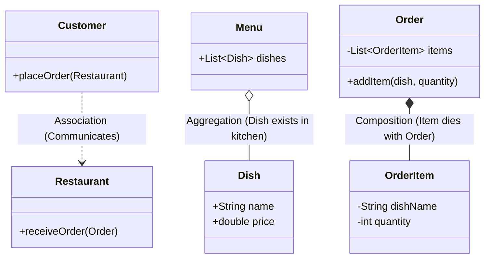

# OOPs in System Design (LLD): Association, Aggregation & Composition

Understanding the distinction between **Association**, **Aggregation**, and **Composition** is one of the most critical transitions from writing plain Java code to designing scalable, production-grade Low-Level Designs (LLD).

---

## 1. Code Review: What You Wrote vs The Reality

Aapne jo 3 files banayi thi, unme aapne bahut accha attempt kiya! Lekin wahan ek **bohot bada trap** tha jisme lagbhag 90% engineers fas jaate hain. Aao dekhein:

### A. Aapka `Association.java` ka doubt:
```java
class B {
    private final int d;
    private A a; // what if i write the final here a = new A() i need to do right.
    B() {
        d = 10;
    }
}
```
> **Aapka Sawal:** *"What if I write `final` here? `a = new A()` karna padega na?"*

**Answer:**
Agar aap class `B` ke andar `private final A a = new A();` kar doge, toh wo **Association nahi rahega! Wo COMPOSITION ban jaayega!**
Kyunki:
1. `B` ne khud `new A()` create kiya.
2. Jab `B` garbage collect hoga, toh `a` bhi mar jaayega.
3. `a` ko bahar se koi aur use nahi kar sakta.

**Association ka asli matlab kya hai?**
Dono classes (`A` aur `B`) aazad (independent) hain. Wo ek doosre ko sirf kaam ke waqt communicate karti hain (e.g. `b.help(a)` me parameter ke roop me pass hona).

---

### B. Aapka `Aggregation.java` (The Classic Trap!):
```java
class Engine { ... }

class Car {
    private Engine engine;
    protected Car() {
        engine = new Engine(); // ❌ ALERT! Ye Aggregation NAHI hai!
    }
}
```

> ⚠️ **The Big Catch:** 
> Jaise hi aapne `Car` ke constructor ke andar `new Engine()` likha, ye **COMPOSITION** ban gaya!
> Kyunki agar car scrap ho gayi, toh uska engine bhi car ke sath hi create hua tha aur destroy ho gaya.

**Aggregation me kya hona chahiye tha?**
Engine bahar factory ya garage me banta hai, aur Car ko pass kiya jaata hai:
```java
class Car {
    private Engine engine;

    // Aggregation: Engine bahar se pass hua!
    public Car(Engine engine) {
        this.engine = engine;
    }
}
```
Agar kal Car crash bhi ho jaaye, toh mechanic Engine nikaal kar kisi doosri car me laga sakta hai! Engine ka apna independent wajood (lifecycle) hai.

---

### C. Aapka `Composition.java`:
```java
class Room { String roomName; }

class House {
    Room room;
    House() {
        room = new Room(); // ✅ PERFECT!
    }
}
```
Ye aapne **100% accurate** likha tha!
Ek `Room` ka akele hawa me koi existence nahi ho sakta bina `House` ke. Agar bulldozer ne `House` tod diya, toh `Room` automatically khatam ho gaya!

---

## 2. The Golden Rule: "The Death Test" (Maut Ka Test) 💀

Interview me jab bhi confuse ho jao, apne aap se sirf **ek question** pucho:

> ### *"Agar Parent Object destroy (delete/null) ho jaye, toh kya Child Object bhi mar jayega?"*

```text
               +---------------------------------------------+
               | If Parent Dies, Does the Child Also Die?    |
               +----------------------+----------------------+
                                      |
                     +----------------+----------------+
                     |                                 |
                  [ YES ]                           [ NO ]
                     |                                 |
              COMPOSITION                         AGGREGATION
           (Strong Ownership)                  (Weak Ownership)
      Example: Order & OrderItem           Example: Cart & Product
      Example: House & Room                Example: Playlist & Song
```

Aur **Association** in dono ka parent category hai:
- **Association:** Any connection where two objects talk to each other.
- **Aggregation:** A special kind of Association (has-a, but independent life).
- **Composition:** The strictest kind of Aggregation (has-a, AND dies together).

---

## 3. Real-World LLD System Design Use Cases

Aao 3 bade systems me in teeno ko dekhein jo interviewers puchte hain:

### System 1: Amazon / Flipkart (E-Commerce)

| Relationship | Real Entities | Code Form | Kyu? (Intuition) |
| :--- | :--- | :--- | :--- |
| **Association** | `Customer` $\leftrightarrow$ `DeliveryPartner` | `partner.deliverTo(customer)` | Dono alag log hain. Order deliver karne ke liye thodi der interact karte hain. |
| **Aggregation** | `ShoppingCart` $\leftrightarrow$ `Product` | `cart.addProduct(product)` | User ne cart delete kar diya toh iPhone catalog se delete nahi hoga! |
| **Composition** | `Order` $\leftrightarrow$ `OrderItem` | `order.addItem("iPhone", 1, 999)` | Order #402 cancel ho gaya toh uski specific order lines hawa me exist nahi kar sakti! |

---

### System 2: Uber / Ola (Ride Sharing)

| Relationship | Real Entities | Code Form | Kyu? (Intuition) |
| :--- | :--- | :--- | :--- |
| **Association** | `Passenger` $\leftrightarrow$ `Driver` | `driver.acceptRide(passenger)` | Sirf ride ke dauran contact hota hai. Dono aazad hain. |
| **Aggregation** | `CabFleet` $\leftrightarrow$ `Cab` | `fleet.registerCab(cab)` | Agar fleet company band ho jaye, toh Car abhi bhi road par chal sakti hai. |
| **Composition** | `Trip` $\leftrightarrow$ `GPSRoutePoint` | `trip.recordLocation(lat, long)` | Wo GPS point sirf usi ride ka part tha. Ride khatam toh un points ka akela koi matlab nahi. |

---

### System 3: Swiggy / Zomato (Food Delivery)



---

## 4. Production Database / Spring Boot me ye kaise dikhta hai?

Jab aap Spring Boot + JPA / Hibernate me kaam karoge, toh ye exact concept database annotations me convert ho jata hai:

### Aggregation in Spring Boot:
```java
// Product exists independently in product table.
// Cart just references product_id.
@ManyToOne
@JoinColumn(name = "product_id")
private Product product;
```

### Composition in Spring Boot:
```java
// If Order is deleted, ALL OrderItems MUST be deleted automatically!
@OneToMany(cascade = CascadeType.ALL, orphanRemoval = true)
@JoinColumn(name = "order_id")
private List<OrderItem> items = new ArrayList<>();
```
Notice: `CascadeType.ALL` aur `orphanRemoval = true` ka matlab hi **COMPOSITION** hai!

---

## 5. Summary Cheat Sheet for Interviews

1. **Association ("Uses-A"):**
   - *Code signature:* Method parameter ke roop me pass hota hai (`void doWork(Other other)`).
   - *Ownership:* None.

2. **Aggregation ("Has-A" - Weak):**
   - *Code signature:* Constructor injection ya setter me bahar se list/object aati hai (`new Cart(products)`).
   - *Ownership:* Container holds a reference, but doesn't control birth/death.

3. **Composition ("Part-Of" - Strong):**
   - *Code signature:* Parent ke constructor ya add method ke andar `new Child()` banta hai (`new OrderItem(...)`).
   - *Ownership:* Strict lifecycle coupling. Parent dies $\rightarrow$ Child dies.

