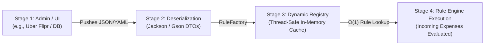

# Production-Grade Rule Engine Architecture (Uber Flipr / Config Service Pattern)

## 1. Aapne Bilkul Sahi Pakda Hai! 🎯

Aapka thought process **100% spot-on** hai!
Ek real enterprise / production server (jaise Uber, Netflix, Stripe, Amazon) me architecture theek aise hi 4 stages me kaam karta hai:



---

## 2. Real World Production Flow: The 4 Stages

### Stage 1: Central Config Service (e.g. Uber Flipr / AWS AppConfig)
* **Kyu chahiye?** Socho Uber ke pass 10,000 microservices chal rahi hain. Agar koi rule ya price limit badalni ho, toh kya 10,000 servers ko restart karoge? Bilkul nahi!
* **Kaise hota hai?** Finance Manager ya Policy Admin ek **Web UI (Admin Portal)** kholta hai aur form fill karta hai:
  - Policy: `Expense Policy 2026`
  - Restaurant Limit: `$75`
  - Airfare: `DISALLOW`
* Form save hote hi Config Service me ek JSON ban jaata hai:

```json
{
  "version": "1.0",
  "categoryRules": [
    {
      "expenseType": "RESTAURANT",
      "rules": [
        { "ruleType": "MAX_AMOUNT", "amount": 75.0 }
      ]
    },
    {
      "expenseType": "AIRFARE",
      "rules": [
        { "ruleType": "DISALLOW" }
      ]
    }
  ],
  "globalRules": [
    { "ruleType": "MAX_AMOUNT", "amount": 200.0 }
  ],
  "tripRules": [
    { "ruleType": "TRIP_TOTAL_MAX", "amount": 1000.0 }
  ]
}
```

---

### Stage 2: Deserialization (JSON $\rightarrow$ Java DTOs)
Jab hamara Java backend start hota hai (ya jab webhook se notify hota hai ki config badal gaya):
* **Jackson `ObjectMapper`** JSON string ko parse karke Java POJOs (DTOs) me convert karta hai:

```java
public class PolicyConfigDTO {
    public String version;
    public List<CategoryRuleConfigDTO> categoryRules;
    public List<RuleDefinitionDTO> globalRules;
    public List<RuleDefinitionDTO> tripRules;
}

public class RuleDefinitionDTO {
    public String ruleType; // "MAX_AMOUNT", "DISALLOW", etc.
    public Double amount;
}
```

---

### Stage 3: The Rule Factory & Dynamic Registry (Mapping to Executable Objects)
JSON ke text `"MAX_AMOUNT"` se CPU evaluation nahi kar sakta. Hume executable Java objects (`MaxAmountRule`, `DisallowRule`) chahiye!

Yahan kaam karta hai **Factory Pattern**:

```java
public class RuleFactory {
    public static ExpenseRule createExpenseRule(RuleDefinitionDTO dto) {
        switch (dto.ruleType) {
            case "MAX_AMOUNT":
                return new MaxAmountRule(dto.amount);
            case "DISALLOW":
                return new DisallowRule();
            default:
                throw new IllegalArgumentException("Unknown rule type: " + dto.ruleType);
        }
    }
}
```

Aur ye saare objects **DynamicRuleRegistry** ke `AtomicReference` ya `ConcurrentHashMap` me load ho jaate hain:
```java
// Thread-safe in-memory cache
private final AtomicReference<RuleBook> currentRuleBook = new AtomicReference<>();
```

---

### Stage 4: High-Performance Execution (Zero Downtime)
Jab employee app se "Submit Expense" dabata hai:
1. `RuleEngine` memory se instant `O(1)` time me `currentRuleBook` read karta hai.
2. Na koi database query, na koi JSON parsing runtime par!
3. Milliseconds me evaluation karke Response bhej deta hai.

---

## 3. The Killer Feature: "Hot Reloading" (Zero-Downtime Rule Updates)

Production me jab Admin UI par limit \$75 se badha kar \$100 ki jaati hai:
1. Uber Flipr / Kafka / Webhook ek event bhejta hai: `"CONFIG_UPDATED"`.
2. Hamara server naya JSON fetch karta hai.
3. Naye Rule objects instantiate karta hai.
4. **Atomic swap** karta hai memory me:
   ```java
   currentRuleBook.set(newRuleBook);
   ```
5. **Zero seconds downtime!** Server restart karne ki zaroorat hi nahi!

---

## 4. Complete Architecture Comparison

| Level | Where Rules are Defined | How Changes are Applied | Downtime | Flexibility |
| :--- | :--- | :--- | :--- | :--- |
| **Junior / Naive** | Hardcoded inside `if-else` in Rule class | Code edit $\rightarrow$ Git commit $\rightarrow$ Build $\rightarrow$ Deploy | Yes (Full restart) | None |
| **Intermediate (Current `RuleRegistry`)** | Central Java Registry file | Java file edit $\rightarrow$ Recompile | Yes (Restart needed) | High in code |
| **Senior / Production (Uber Flipr Pattern)** | External JSON / DB / Config Service | Admin UI edit $\rightarrow$ Hot Reload via Webhook / Kafka | **ZERO Downtime** | Ultimate |

