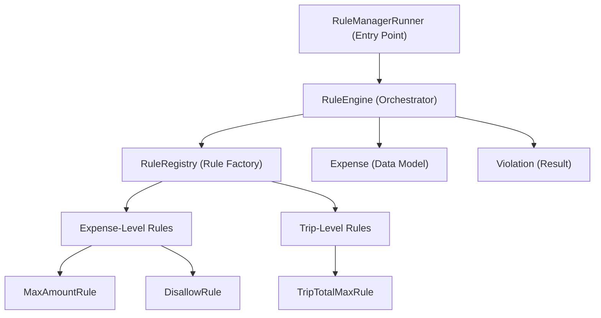

# Rule Engine LLD: Expense Policy System — Complete Deep Dive

## Problem Statement (Hinglish Mein Samjho)

Bhai soch, tu ek **badi company** mein kaam karta hai (Google, TCS, Infosys kuch bhi). Company tujhe
ek **corporate card** deti hai. Tu business trip pe jaata hai — flight liya, hotel liya, restaurant
mein khaana khaaya, entertainment show dekha. Ab sab kuch company ke paise se hoga na?

Lekin company ko **control** chahiye! Nahi toh koi bhi employee \$5000 ka dinner kha le aur bol de
"business expense tha." 😂

Toh **Manager** ek set of **rules** banata hai:
- "Bhai restaurant mein \$75 se zyada mat kharcho"
- "Flight ki ticket bilkul allowed nahi hai" (maybe company ka khud ka jet hai 😄)
- "Entertainment pe paisa waste mat karo"
- "Koi bhi single expense \$250 se upar nahi hona chahiye"

Aur trip level pe bhi rules hain:
- "Poori trip ka total \$2000 se zyada nahi hona chahiye"
- "Trip mein total meals \$10,000 se zyada nahi"

**Tera kaam:** Ek system design kar jo:
1. Har expense ko check kare — "ye rule todta hai ya nahi?"
2. Poori trip ke expenses ko combine karke check kare — "trip ka total limit cross karta hai ya nahi?"
3. Agar rule toota hai toh clearly bataye — "REJECTED: Restaurant expense exceeded \$75"

---

## Interview Level: Kya Level Ka Problem Hai Ye?

| Aspect | Rating |
|--------|--------|
| **Difficulty** | Medium-Hard (Senior SDE / SDE-2 level) |
| **Type** | LLD (Low-Level Design) + Strategy/Plugin Architecture |
| **Time Expected** | 45-60 minutes in a real interview |
| **Why it's asked** | Tests if you can build EXTENSIBLE systems. Can you add new rules WITHOUT modifying existing code? |

> [!IMPORTANT]
> This is NOT a DSA problem. This is a **design** problem. The interviewer wants to see how you
> structure your classes, interfaces, and how easily new rules can be plugged in.

---

## How to Approach This Problem (Step by Step)

### Step 1: Identify the Entities (Nouns)
Ask yourself: "Problem mein kya kya **cheezein** hain?"

- **Expense** — Ek single kharcha (restaurant bill, flight ticket)
- **ExpenseType** — Kis category ka kharcha hai (RESTAURANT, AIRFARE, ENTERTAINMENT)
- **Violation** — Agar rule toota toh ye message aayega
- **Rule** — Ek condition jo check karni hai

### Step 2: Identify the Actions (Verbs)
- **Check** — Kya ye expense rule follow karta hai?
- **Evaluate** — Saari expenses pe saare rules lagao
- **Flag** — Violation mila toh usse report karo

### Step 3: Identify the Two Levels of Rules
Ye problem ka **core trick** hai jo interview mein catch karna zaroori hai:

```
Rules
├── Expense-Level Rules (Ek expense pe lagta hai)
│   ├── "Restaurant > $75? REJECT"
│   ├── "Airfare? REJECT"
│   └── "Any expense > $250? REJECT"
│
└── Trip-Level Rules (Poori trip ke expenses pe lagta hai)
    ├── "Trip total > $2000? REJECT"
    └── "Trip meals total > $10,000? REJECT"
```

> [!TIP]
> Interview mein pehle ye distinction clearly batao. Bahut se candidates sirf expense-level
> rules sochte hain aur trip-level bhool jaate hain. Ye senior thinking dikhata hai.

---

## The Architecture: Class by Class Breakdown



---

## Code Breakdown: Line by Line

### 1. Expense Model — "Kharcha Ka Data"

```java
public class Expense {
    private final String expenseId;    // Unique ID: "EXP-001"
    private final String tripId;       // Kis trip ka hai: "TRIP-HYD-01"
    private final Double amountUsed;   // Kitna kharcha: 80.0
    private ExpenseType expenseType;   // Kis type ka: RESTAURANT
}
```

**Intuition:** Ye ek simple POJO (Plain Old Java Object) hai. Isme koi business logic nahi hai.
Ye sirf **data hold** karta hai. Jaise ek bill receipt pe likha hota hai — amount, type, trip ID.

### 2. ExpenseType Enum — "Kharche Ki Categories"

```java
public enum ExpenseType {
    RESTAURANT, AIRFARE, ENTERTAINMENT
}
```

**Intuition:** Enum isliye use kiya kyunki categories **fixed** hain. String use karte toh koi
"restaurant", koi "RESTAURANT", koi "Restaurant" likhta — bugs aate.

### 3. Violation — "Rule Todne Ka Report Card"

```java
public class Violation {
    private final String message;

    private Violation(String message) { this.message = message; }

    public static Violation of(String message) {
        return new Violation(message);
    }
}
```

**Intuition:** Ye ek **immutable result** hai. Private constructor + static factory method (`Violation.of(...)`)
ka pattern use kiya hai.

**Kyu private constructor?** Taaki koi directly `new Violation()` na kar sake. Har Violation
sirf `Violation.of("message")` se bane. Ye **Static Factory Method Pattern** hai — same cheez
Java mein `Optional.of()`, `List.of()` mein bhi dikhti hai.

### 4. ExpenseRule Interface — "Ek Expense Pe Lagane Wala Rule"

```java
public interface ExpenseRule {
    Optional<Violation> check(Expense expense);
}
```

**Intuition:** Ye sab se important interface hai!

- Input: Ek single `Expense`
- Output: `Optional<Violation>` — matlab ya toh violation mila (`Optional.of(violation)`)
  ya sab theek hai (`Optional.empty()`)

**Kyu `Optional`?** Kyunki har expense pe har rule violate nahi hoga. Kuch expenses
sahi honge. `Optional` se explicitly pata chalta hai — "result ho bhi sakta hai, nahi bhi."

**Kyu interface?** Kyunki **100 alag alag rules** ho sakte hain! Agar ek class mein
sab daalega toh god class ban jaayega. Interface se har rule apni alag class mein rehta hai.
Ye **Strategy Pattern + OCP** ka combination hai.

### 5. TripRule Interface — "Poori Trip Pe Lagane Wala Rule"

```java
public interface TripRule {
    Optional<Violation> check(List<Expense> expenses);
}
```

**Intuition:** Same concept, but input alag hai. ExpenseRule ko ek expense milta hai,
TripRule ko ek **list of expenses** milti hai (ek poori trip ke saare kharche).

**Kyu alag interface?** Ye **ISP (Interface Segregation)** follow karta hai.
Agar dono ko ek interface mein daalta toh `MaxAmountRule` ko bhi
`check(List<Expense>)` implement karna padta jo usme sense nahi banata.

### 6. MaxAmountRule — "Itne Se Zyada Kharcha Mat Kar"

```java
public class MaxAmountRule implements ExpenseRule {
    private final double maxAmount;

    public MaxAmountRule(double maxAmount) {
        this.maxAmount = maxAmount;
    }

    @Override
    public Optional<Violation> check(Expense e) {
        if (e.getAmountUsed() > maxAmount) {
            return Optional.of(Violation.of("Expense exceeds max: " + maxAmount));
        }
        return Optional.empty();
    }
}
```

**Intuition:** Ye ek **configurable rule** hai. Constructor mein `maxAmount` pass karte ho.

- `new MaxAmountRule(75)` → Restaurant ke liye: "\$75 se zyada nahi"
- `new MaxAmountRule(250)` → General rule: "Koi bhi expense \$250 se zyada nahi"

**Same class, different config, different behavior.** Ye OCP ka beautiful example hai.
Naya limit chahiye? Naya object banao, code mat badlo.

### 7. DisallowRule — "Ye Type Ka Kharcha Allowed Hi Nahi Hai"

```java
public class DisallowRule implements ExpenseRule {
    @Override
    public Optional<Violation> check(Expense e) {
        return Optional.of(Violation.of(
            "Expense type " + e.getExpenseType() + " is not allowed"));
    }
}
```

**Intuition:** Ye **always violation return karta hai**. Koi check nahi. Agar ye rule
kisi expense type pe lagaya gaya hai toh matlab wo type hi banned hai.

Registry mein dekhoge: `registry.put(ExpenseType.AIRFARE, List.of(new DisallowRule()))` —
iska matlab AIRFARE type ka expense aaye toh **seedha reject**.

### 8. TripTotalMaxRule — "Poori Trip Ka Total Itne Se Zyada Nahi"

```java
public class TripTotalMaxRule implements TripRule {
    private final double maxAmount;

    @Override
    public Optional<Violation> check(List<Expense> expenses) {
        // Safety check: saare expenses same trip ke hain?
        if (!ExpenseUtils.areAllExpensesOfSameTrip(expenses)) {
            return Optional.of(Violation.of("Expenses are not of the same trip"));
        }

        double total = 0;
        for (Expense expense : expenses) {
            total += expense.getAmountUsed();
        }

        if (total > maxAmount) {
            return Optional.of(Violation.of("Trip total exceeds " + maxAmount));
        }
        return Optional.empty();
    }
}
```

**Intuition:** Ye **aggregation** ka concept hai. Ek expense toh \$100 hai, doosra \$150 hai —
individually dono theek hain. Lekin jab milao toh total \$250 ho gaya. Agar trip limit \$200 hai
toh **individually sab pass, but combined fail**.

**Safety check kyu?** `areAllExpensesOfSameTrip()` check karta hai ki galti se do alag
trips ke expenses mix toh nahi ho gaye. Ye **defensive programming** hai.

### 9. RuleRegistry — "Rules Ka Phone Book"

```java
public class RuleRegistry {
    public static Map<ExpenseType, List<ExpenseRule>> getExpenseRulesRegistry() {
        Map<ExpenseType, List<ExpenseRule>> registry = new HashMap<>();
        registry.put(ExpenseType.RESTAURANT, List.of(new MaxAmountRule(75)));
        registry.put(ExpenseType.AIRFARE, List.of(new DisallowRule()));
        return registry;
    }

    public static List<ExpenseRule> getAllExpenseRulesRegistry() {
        return List.of(new MaxAmountRule(200));
    }

    public static List<TripRule> getAllTripRulesRegistry() {
        return List.of(new TripTotalMaxRule(1000));
    }
}
```

**Intuition:** Ye woh jagah hai jahaan tu **rules configure** karta hai.

Think of it as a **config file in Java form**:
- RESTAURANT expenses pe `MaxAmountRule(75)` lagega
- AIRFARE expenses pe `DisallowRule()` lagega (completely banned)
- **Saare** expenses pe `MaxAmountRule(200)` lagega (global cap)
- Trip level pe `TripTotalMaxRule(1000)` lagega

**Kyu 3 alag methods?**
1. `getExpenseRulesRegistry()` → Type-specific rules (Map: ExpenseType → Rules)
2. `getAllExpenseRulesRegistry()` → Rules jo SABHI expenses pe lagte hain
3. `getAllTripRulesRegistry()` → Trip-level aggregation rules

### 10. RuleEngine Interface — "Orchestrator Ka Contract"

```java
public interface RuleEngine {
    List<Violation> evaluate(
        List<Expense> expenses,
        Map<ExpenseType, List<ExpenseRule>> expenseRulesRegistry,
        List<ExpenseRule> allExpenseRulesRegistry,
        List<TripRule> tripRulesRegistry
    );
}
```

**Intuition:** Ye orchestrator ka **contract** hai. Implementation mein ye sab kaam hoga:

```
For each expense:
    1. Uska type dekho (RESTAURANT? AIRFARE?)
    2. Us type ke specific rules lagao (e.g., MaxAmountRule(75))
    3. Global rules bhi lagao (e.g., MaxAmountRule(250))
    4. Violations collect karo

Group expenses by tripId:
    5. Har trip ke expenses pe trip rules lagao (e.g., TripTotalMaxRule(2000))
    6. Violations collect karo

Return all violations
```

### 11. RuleManagerRunner — "Application Ka Entry Point"

```java
public class RuleManagerRunner {
    private final RuleEngine ruleEngine;

    public RuleManagerRunner(RuleEngine ruleEngine) {
        this.ruleEngine = ruleEngine;  // DIP: Depends on interface, not impl
    }

    public void run(List<Expense> expenses) {
        // 1. Registry se saare rules le aao
        Map<ExpenseType, List<ExpenseRule>> expenseRulesRegistry = RuleRegistry.getExpenseRulesRegistry();
        List<ExpenseRule> allExpenseRulesRegistry = RuleRegistry.getAllExpenseRulesRegistry();
        List<TripRule> tripRulesRegistry = RuleRegistry.getAllTripRulesRegistry();

        // 2. Engine ko bolo: "ye expenses hain, ye rules hain, evaluate kar"
        List<Violation> violations = ruleEngine.evaluate(
            expenses, expenseRulesRegistry, allExpenseRulesRegistry, tripRulesRegistry);

        // 3. Violations print kar
        for (Violation v : violations) {
            System.out.println(v.getMessage());
        }
    }
}
```

**Intuition:** Ye **Facade Pattern** hai. Bahar se dekhne wale ko sirf ye class dikhti hai.
Andar kitni complexity hai, usse koi matlab nahi.

---

## Design Patterns Used (Naturally, Not Forced)

| Domain Requirement | Pattern That Emerged | Why |
|----|----|----|
| Multiple types of rules with same contract | **Strategy Pattern** | `ExpenseRule` interface with multiple implementations |
| Rules should be pluggable & configurable | **Registry / Factory Pattern** | `RuleRegistry` creates and groups rules |
| Entry point should hide internal complexity | **Facade Pattern** | `RuleManagerRunner` coordinates everything |
| High-level modules shouldn't depend on low-level | **DIP** | `RuleManagerRunner` depends on `RuleEngine` interface |
| Adding new rules shouldn't modify existing code | **OCP** | Just create a new class implementing `ExpenseRule` |
| Expense rules & Trip rules are separate concerns | **ISP** | Two separate interfaces: `ExpenseRule`, `TripRule` |

---

## The Power of This Design: Adding New Rules

Kal agar manager bole "Bhai ab **Hotel expenses pe \$300 ki limit** lagao," toh:

1. `ExpenseType` mein add karo: `HOTEL`
2. `RuleRegistry` mein add karo: `registry.put(ExpenseType.HOTEL, List.of(new MaxAmountRule(300)))`

**Bas. Koi existing class modify nahi hua.** Ye hai OCP ka power!

Agar ek completely naya type of rule chahiye (e.g., "Weekend pe expenses double allowed hain"),
toh:
1. Ek naya class banao: `WeekendDoubleRule implements ExpenseRule`
2. Registry mein register karo.

**Again, no existing code touched.**

---

## Summary: Tera Brain Ka Mental Model

```
Employee submits expenses
        ↓
RuleManagerRunner picks up expenses
        ↓
Loads rules from RuleRegistry (the config)
        ↓
Passes to RuleEngine (the brain)
        ↓
Engine runs EACH expense through:
   ├── Type-specific rules (RESTAURANT → $75 max)
   └── Global rules (ANY expense → $250 max)
        ↓
Engine GROUPS expenses by Trip ID, then runs:
   └── Trip rules (Total → $2000 max)
        ↓
Collects all Violations
        ↓
Returns: "REJECTED: Restaurant expense exceeded $75"
```

