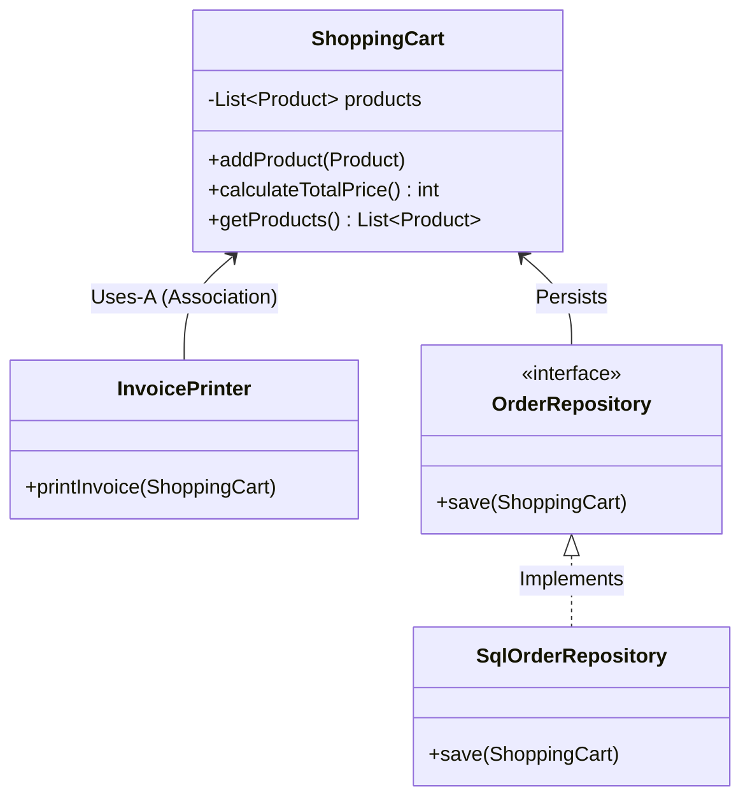
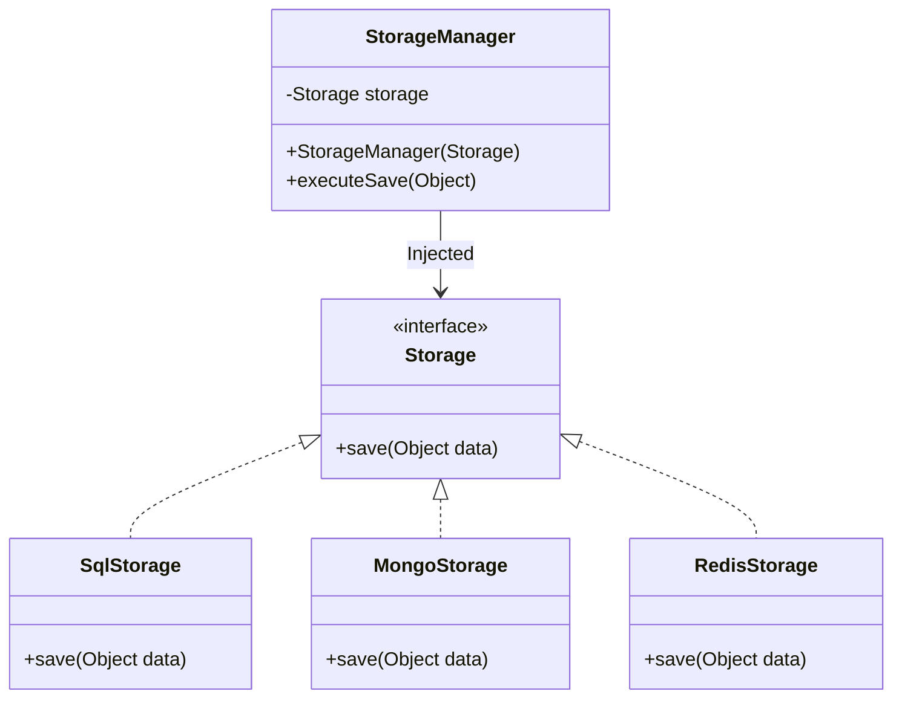
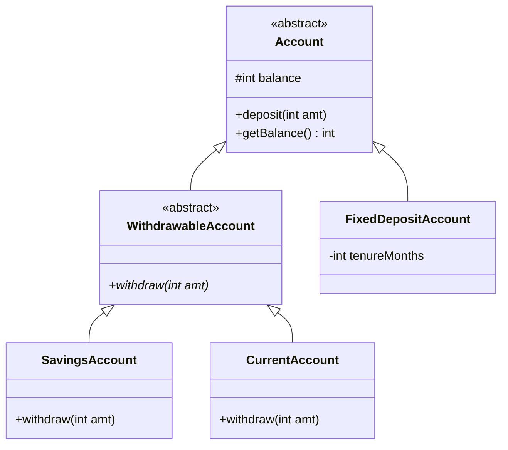
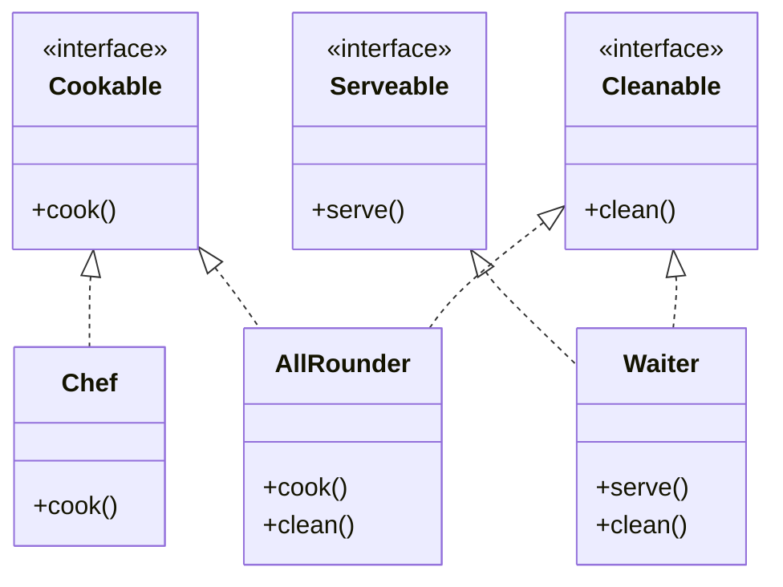
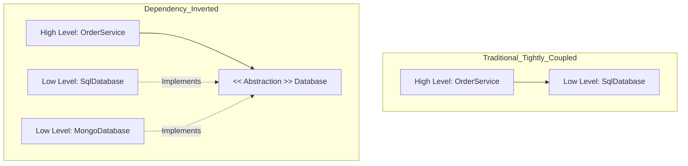

# SOLID Principles: Masterclass & Production Low-Level Design (LLD) Guide

The **SOLID** principles are the cornerstone of object-oriented architecture and low-level design. Formulated by Robert C. Martin ("Uncle Bob") and Barbara Liskov, they guide engineers in writing code that is **maintainable**, **testable**, **loosely coupled**, and **resilient to change**.

In production and system design interviews, demonstrating *why* a principle is violated and *how* to refactor it using patterns is what differentiates junior developers from senior architects.

---

## Quick Navigation
1. [S — Single Responsibility Principle (SRP)](#1-single-responsibility-principle-srp)
2. [O — Open/Closed Principle (OCP)](#2-openclosed-principle-ocp)
3. [L — Liskov Substitution Principle (LSP)](#3-liskov-substitution-principle-lsp)
4. [I — Interface Segregation Principle (ISP)](#4-interface-segregation-principle-isp)
5. [D — Dependency Inversion Principle (DIP)](#5-dependency-inversion-principle-dip)
6. [Architectural Comparison & Interview Cheat Sheet](#6-architectural-comparison--interview-cheat-sheet)

---

## 1. Single Responsibility Principle (SRP)

> **"A class should have one, and only one, reason to change."**  
> — Robert C. Martin

### 💡 Core Intuition
A class should encapsulate only a single responsibility or business domain actor. If business rules change for printing, calculation, or database storage, only the corresponding class should be modified.

---

### ❌ The Violation: God Class (Multiple Actors)
Consider an e-commerce checkout flow:

```java
// VIOLATION: ShoppingCart has 3 completely distinct reasons to change!
class ShoppingCart {
    private List<Product> products = new ArrayList<>();

    public void addProduct(Product p) { products.add(p); }

    // Responsibility 1: Cart business math (Finance/Pricing actor)
    public int calculateTotalPrice() {
        return products.stream().mapToInt(Product::getPrice).sum();
    }

    // Responsibility 2: Presentation & Formatting (UX/UI actor)
    public void printInvoice() {
        System.out.println("Invoice: Total = " + calculateTotalPrice());
    }

    // Responsibility 3: Persistence (Data Engineering/DB actor)
    public void saveToDatabase() {
        System.out.println("Executing INSERT INTO orders...");
    }
}
```

#### Why this breaks in production:
1. **Merge Conflicts:** If the billing team updates tax calculation while the marketing team changes invoice formatting, both touch `ShoppingCart.java`.
2. **Fragile Testing:** You cannot unit test cart business logic without dragging along formatting and persistence mock dependencies.
3. **Reusability Bottleneck:** You cannot render the invoice in PDF or mobile JSON without rewriting or polluting `ShoppingCart`.

---

### ✅ The Solution: Separated Responsibilities



#### Refactored Code:
```java
// 1. Domain Model & Cart Math
public class ShoppingCart {
    private final List<Product> items = new ArrayList<>();

    public void addItem(Product product) { items.add(product); }
    public List<Product> getItems() { return Collections.unmodifiableList(items); }

    public int calculateTotalPrice() {
        return items.stream().mapToInt(Product::getPrice).sum();
    }
}

// 2. Presentation Responsibility
public class InvoicePrinter {
    public void printConsole(ShoppingCart cart) {
        System.out.println("====== ORDER INVOICE ======");
        for (Product item : cart.getItems()) {
            System.out.printf("%s : $%d\n", item.getName(), item.getPrice());
        }
        System.out.println("Total Due: $" + cart.calculateTotalPrice());
    }
}

// 3. Persistence Responsibility
public interface OrderRepository {
    void save(ShoppingCart cart);
}

public class SqlOrderRepository implements OrderRepository {
    @Override
    public void save(ShoppingCart cart) {
        System.out.println("Persisting order to PostgreSQL database...");
    }
}
```

> **LLD Insight (Association vs Composition):**  
> Notice that `InvoicePrinter.printConsole(ShoppingCart cart)` receives `ShoppingCart` as a method argument. This is pure **Association ("Uses-A")**, not Composition. `InvoicePrinter` does not own the cart; its lifecycle is completely decoupled.

---

## 2. Open/Closed Principle (OCP)

> **"Software entities (classes, modules, functions) should be open for extension, but closed for modification."**  
> — Bertrand Meyer

### 💡 Core Intuition
You should be able to add new functionality (e.g., a new payment gateway, new storage engine, new discount strategy) without touching or editing existing, tested source code.

---

### ❌ The Violation: The `if-else` / `switch` Trap
```java
// VIOLATION: Adding Redis or S3 requires modifying this class!
public class StorageService {
    public void save(String type, Object data) {
        if ("sql".equalsIgnoreCase(type)) {
            System.out.println("Saving to SQL Database");
        } else if ("mongo".equalsIgnoreCase(type)) {
            System.out.println("Saving to MongoDB");
        } else if ("redis".equalsIgnoreCase(type)) {
            System.out.println("Saving to Redis Cache");
        } else {
            throw new IllegalArgumentException("Unsupported storage: " + type);
        }
    }
}
```

#### Why this breaks in production:
- Every new storage type requires editing `StorageService.java`.
- Risk of breaking existing regression tests for SQL or Mongo whenever a change is made.
- Violates the core tenet of stable shared libraries.

---

### ✅ The Solution: Polymorphic Strategy & Abstraction



#### Refactored Code:
```java
// 1. Abstraction (Closed for modification)
public interface Storage {
    void save(Object data);
}

// 2. Concrete Extensions (Open for extension)
public class SqlStorage implements Storage {
    @Override
    public void save(Object data) {
        System.out.println("Saving record into Relational SQL Database.");
    }
}

public class MongoStorage implements Storage {
    @Override
    public void save(Object data) {
        System.out.println("Saving JSON document into MongoDB.");
    }
}

// Adding Redis tomorrow requires ZERO changes to existing classes!
public class RedisStorage implements Storage {
    @Override
    public void save(Object data) {
        System.out.println("Caching key-value pair in Redis cluster.");
    }
}

// 3. Client depends strictly on Abstraction
public class StorageManager {
    private final Storage storage;

    public StorageManager(Storage storage) {
        this.storage = storage;
    }

    public void persist(Object data) {
        storage.save(data);
    }
}
```

---

## 3. Liskov Substitution Principle (LSP)

> **"If $S$ is a subtype of $T$, then objects of type $T$ may be replaced with objects of type $S$ without altering any of the desirable properties of the program (correctness, task performed, etc.)."**  
> — Barbara Liskov

### 💡 Core Intuition
A child class must be fully substitutable for its parent class. If a client expects an `Account` and calls `withdraw()`, substituting any subclass should never crash, throw unexpected exceptions, or violate domain invariants.

---

### ❌ The Classic Violation: Square-Rectangle & FixedDeposit Trap
```java
// VIOLATION: FixedDeposit extends Account but cannot withdraw!
class Account {
    protected int balance;
    public void deposit(int amt) { balance += amt; }
    public void withdraw(int amt) { balance -= amt; }
}

class FixedDeposit extends Account {
    @Override
    public void withdraw(int amt) {
        // Run-time disaster waiting to happen!
        throw new UnsupportedOperationException("Withdrawals are locked on Fixed Deposits!");
    }
}

// Client code expecting Account:
public void processBanking(Account acc) {
    acc.withdraw(500); // 💥 Crashes at runtime if acc is FixedDeposit!
}
```

---

### 📜 The 6 Formal Rules of LSP (Interview Gold)

1. **Precondition Rule:** Subclasses cannot strengthen preconditions (cannot require more than the parent).
2. **Postcondition Rule:** Subclasses cannot weaken postconditions (must guarantee at least as much as the parent).
3. **Invariant Rule:** Subclasses must preserve all class invariants (e.g., balance $\ge 0$).
4. **History Constraint:** Subclasses cannot modify state in ways the parent disallowed (e.g., mutating an immutable field).
5. **Signature Rule (Contravariance & Covariance):**
   - Method return types can be **covariant** (narrower / subtype).
   - Method parameters can be **contravariant** (broader / supertype, where supported by language).
6. **Exception Rule:** Subclasses can only throw exceptions that are subtypes of parent-declared exceptions, or unchecked exceptions within the contract.

---

### ✅ The Solution: Contract-Segregated Hierarchy



#### Refactored Code with Invariant Guard:
```java
// Base contract: all accounts support deposit and balance inspection
public abstract class Account {
    protected int balance;

    public void deposit(int amount) {
        if (amount <= 0) throw new IllegalArgumentException("Deposit amount must be positive");
        this.balance += amount;
    }

    public int getBalance() {
        return balance;
    }
}

// Specialized capability contract
public abstract class WithdrawableAccount extends Account {
    public abstract void withdraw(int amount);
}

public class SavingsAccount extends WithdrawableAccount {
    @Override
    public void withdraw(int amount) {
        // Enforcing Invariant Rule: balance cannot be negative
        if (amount > 0 && amount <= balance) {
            balance -= amount;
            System.out.println("Savings withdrawal successful. New balance: " + balance);
        } else {
            throw new IllegalStateException("Insufficient funds or invalid withdrawal amount.");
        }
    }
}

// FixedDeposit is an Account, but NOT a WithdrawableAccount!
public class FixedDepositAccount extends Account {
    private final int lockInMonths;

    public FixedDepositAccount(int lockInMonths) {
        this.lockInMonths = lockInMonths;
    }
    // Safe! No dummy or throwing methods.
}
```

---

## 4. Interface Segregation Principle (ISP)

> **"Clients should not be forced to depend upon interfaces that they do not use."**  
> — Robert C. Martin

### 💡 Core Intuition
Prefer small, client-specific **Role Interfaces** over large, general-purpose **"Fat" Interfaces**. No class should be burdened with implementing methods it has no business executing.

---

### ❌ The Violation: The "Fat" Interface Trap
```java
// VIOLATION: Forcing unrelated roles into one giant interface
public interface RestaurantWorker {
    void cook();
    void serve();
    void clean();
}

public class Waiter implements RestaurantWorker {
    @Override public void serve() { System.out.println("Serving food."); }
    @Override public void cook() { throw new UnsupportedOperationException("Waiters don't cook!"); }
    @Override public void clean() { System.out.println("Cleaning table."); }
}
```

---

### ✅ The Solution: Role Interfaces as "Lego Blocks"



#### Refactored Code:
```java
public interface Cookable {
    void cook();
}

public interface Serveable {
    void serve();
}

public interface Cleanable {
    void clean();
}

// Role 1: Chef only cooks
public class Chef implements Cookable {
    @Override
    public void cook() { System.out.println("Chef is preparing gourmet meal."); }
}

// Role 2: Waiter serves and cleans
public class Waiter implements Serveable, Cleanable {
    @Override
    public void serve() { System.out.println("Waiter is serving food."); }
    @Override
    public void clean() { System.out.println("Waiter is cleaning table."); }
}

// Multi-role composition: small café all-rounder
public class RestaurantAllRounder implements Cookable, Cleanable {
    @Override
    public void cook() { System.out.println("Preparing quick breakfast items."); }
    @Override
    public void clean() { System.out.println("Wiping kitchen counters."); }
}
```

---

## 5. Dependency Inversion Principle (DIP)

> **1. High-level modules should not depend on low-level modules. Both should depend on abstractions.**  
> **2. Abstractions should not depend on details. Details should depend on abstractions.**  
> — Robert C. Martin

### 💡 Core Intuition & The Three Concepts
Often confused in interviews:
- **DIP (Principle):** The architectural guideline saying high-level policy shouldn't depend on low-level plumbing.
- **DI (Dependency Injection, Pattern):** The technique of providing dependencies from the outside (Constructor, Setter, or Field).
- **IoC (Inversion of Control, Framework Mechanism):** Inverting runtime control to an orchestrator or container (e.g., Spring IoC Container).

---

### ❌ The Violation: Tight Coupling to Concrete Classes
```java
// VIOLATION: High-level business logic is hardcoded to SQL Database
public class OrderService {
    // Direct instantiation couples OrderService to SQL forever!
    private SqlDatabase database = new SqlDatabase();

    public void processOrder(Order order) {
        database.insert(order);
    }
}
```

---

### ✅ The Solution: Inverting the Dependency Arrow



#### Refactored Code:
```java
// 1. Abstraction owned by domain/business layer
public interface Database {
    void save(Object data);
}

// 2. Low-level plugins / adapters
public class SqlDatabase implements Database {
    @Override
    public void save(Object data) {
        System.out.println("Persisting to PostgreSQL via JDBC.");
    }
}

public class MongoDatabase implements Database {
    @Override
    public void save(Object data) {
        System.out.println("Persisting to MongoDB cluster.");
    }
}

// 3. High-level orchestrator receives abstraction via Constructor Injection
public class OrderService {
    private final Database database;

    // Injected from outside (Spring @Autowired or manual bootstrap)
    public OrderService(Database database) {
        this.database = Objects.requireNonNull(database, "Database dependency cannot be null");
    }

    public void completeOrder(Object orderData) {
        System.out.println("Processing domain order logic...");
        database.save(orderData);
    }
}
```

---

## 6. Architectural Comparison & Interview Cheat Sheet

| Principle | Primary Enemy | Key Design Pattern | Real-World Metaphor |
| :--- | :--- | :--- | :--- |
| **S - Single Responsibility** | God Classes, Shared mutable reasons to change | Facade, Repository, Service Layer | Swiss Army knife vs set of precision tools |
| **O - Open / Closed** | Fragile `switch` / `if-else` branching | Strategy, Template Method, Decorator | Electrical wall socket (plug in any device) |
| **L - Liskov Substitution** | `UnsupportedOperationException`, Broken invariants | Abstract capability base classes | Battery slot (AAA from any brand works safely) |
| **I - Interface Segregation** | Fat interfaces with dummy implementations | Role Interfaces, Adapters | USB-C cable (standard dedicated pins vs bloated adapter) |
| **D - Dependency Inversion** | `new ConcreteClass()` in business services | Dependency Injection, Factory, IoC | Wall power outlet instead of soldering wires into wall |

### OCP vs DIP: What is the relationship?
- **OCP is the Goal:** "I want to add new storage engines without touching my existing code."
- **DIP is the Vehicle:** "By making my business logic depend on a `Database` interface and injecting implementations, I achieve OCP."
